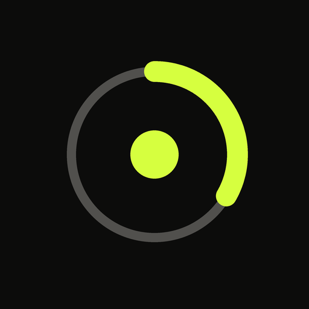
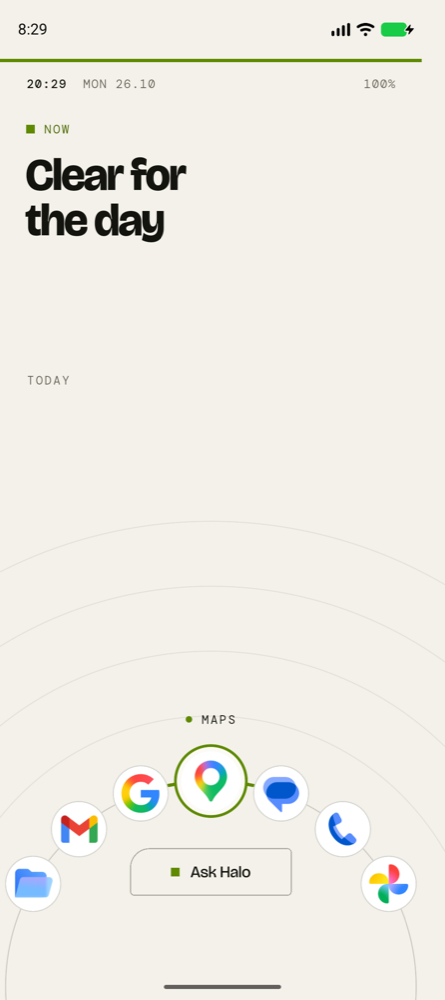
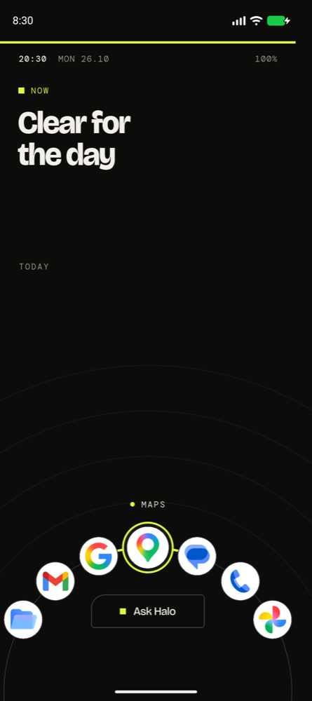

# Halo Launcher



An Android home-screen launcher built with Flutter, based on the Halo design language.

> No grid · No glass · No dock.

Halo puts what matters now at the top of the screen and your apps on an arc within thumb reach. Notifications become one stream that Halo summarizes. Controls look like controls.

| Lock | Home | Recents | Switchboard | Stream | System |
|---|---|---|---|---|---|
|  |  |  |  |  |  |

Every screen also has a light version (`design/screens/*_light.png`).

On Android today (Phase 1): your installed apps on the arc, with their own icons.

| Light | Dark |
|---|---|
|  |  |

## Status

Pre-alpha. On Android, Halo can become the default home app; your chosen apps sit on the arc, and every app is in the Apps list (swipe up on the arc), with search across apps, contacts and settings, and a long-press menu. Today's calendar shows on Home, and Stream shows your notifications, where you can open, swipe away, reply to or snooze them. Quick controls and Recents come next. All six screens also run on macOS with the design's mock data. See [ROADMAP.md](ROADMAP.md).

## What it does on Android

| Screen | On Android |
|---|---|
| **Home Arc** | The launcher's home screen (`CATEGORY_HOME`). Installed apps sit on the arc, with "now", today's agenda and the top message above it. |
| **Stream** | Notifications from every app, read through a notification listener and summarized by Halo. |
| **Switchboard** | Quick controls: brightness, volume, media, battery, and connection toggles where Android allows it. |
| **Recents** | Recently used apps, from usage stats. |
| **System** | The launcher's own settings (appearance, text size, arc apps), plus shortcuts into Android Settings. |
| **Lock** | Android doesn't let a launcher replace the lock screen. The Lock design becomes an at-a-glance screen inside the launcher (see the open questions in the roadmap). |

## Layout

```
design/      design exports (PNG) and sources (.dc.html). The visual reference
docs/        design system and project docs
packages/    halo_ui (tokens, fonts, widgets), halo_sdk (service API and mock),
             halo_android (Kotlin platform layer and the Android backend)
launcher/    the launcher app (Flutter)
```

## Run it

```sh
# On an Android phone or emulator (Android 10 or later)
cd launcher && flutter run -d <device>
# Then press Home and pick Halo, or tap Yes on the "Set Halo as home?" card.

# On macOS, 390 × 844 window, mock data
cd launcher && flutter run -d macos

# Token and widget gallery
cd packages/halo_ui/example && flutter run -d macos
```

## Documentation

- [ROADMAP.md](ROADMAP.md): phases and exit criteria
- [docs/ARCHITECTURE.md](docs/ARCHITECTURE.md): the launcher app, the platform layer, testing
- [docs/DESIGN_SYSTEM.md](docs/DESIGN_SYSTEM.md): tokens, components, screens
- [docs/DECISIONS.md](docs/DECISIONS.md): decision log
- [CLAUDE.md](CLAUDE.md): working guide for AI agents and contributors
